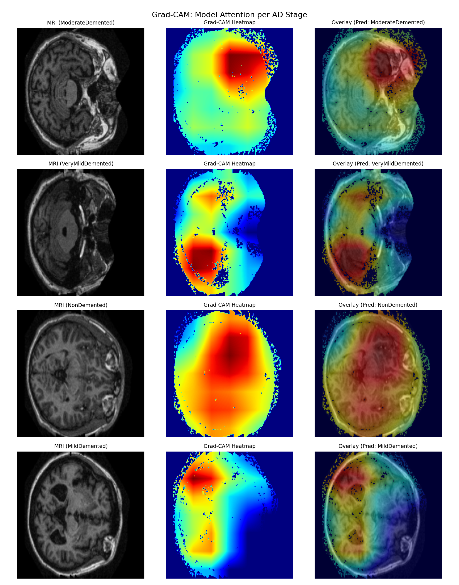
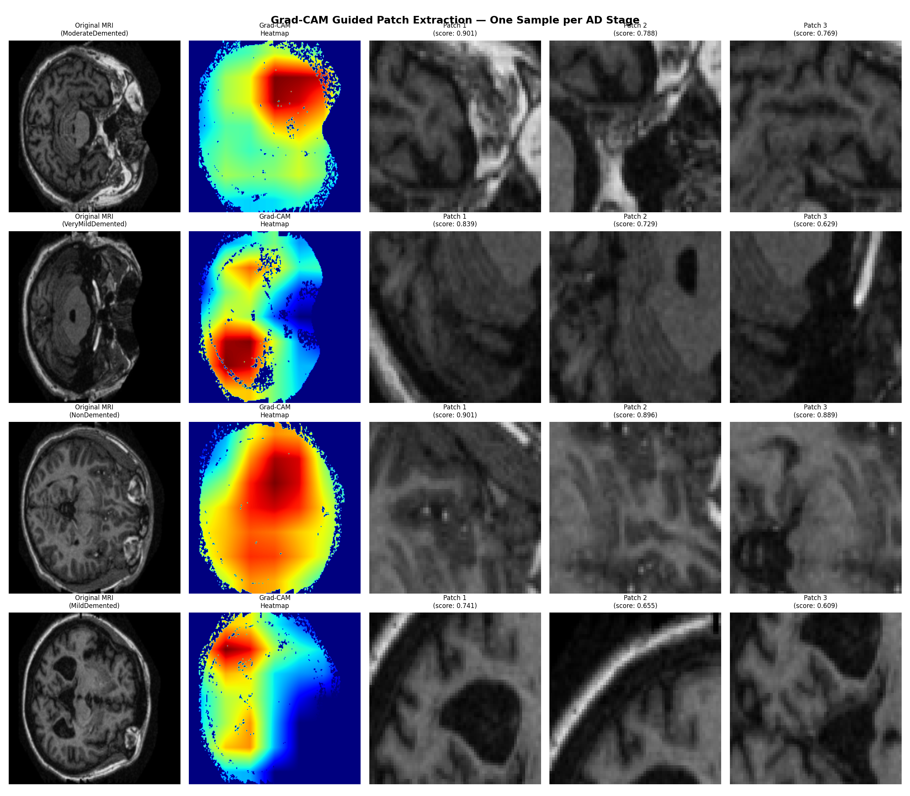
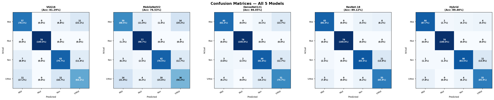

# Explainable Deep Learning for Alzheimer's Disease MRI Classification

[](https://www.python.org/)
[](https://pytorch.org/)
[](https://opensource.org/licenses/MIT)
[](https://www.utm.my/)

An explainable, multi-stage deep learning framework for multi-class **Alzheimer's Disease (AD)** stage detection from structural brain Magnetic Resonance Imaging (MRI). 

This undergraduate thesis project introduces an attention-guided hybrid ensemble architecture: a global **ResNet-18** feature extractor coupled with an explainable **Grad-CAM** saliency pipeline that extracts localized, disease-critical neurodegeneration patches to train an auxiliary **PatchCNN**. Probabilistically combining global spatial features with localized lesion attention achieves **95.16% test accuracy** (with the standalone ResNet-18 backbone achieving **95.08%**) on the primary evaluation cohort across 4 clinical stages.

---

## Key Highlights

* **Explainable AI by Design:** Employs Gradient-weighted Class Activation Mapping (Grad-CAM) with automated skull-stripping masks to identify focal hippocampal and ventriculomegaly degeneration.
* **Two-Stage Hybrid Architecture:** Fuses whole-brain spatial representations with high-resolution localized lesion features, outperforming standard monolithic architectures.
* **Rigorous Imbalance Mitigation:** Addresses extreme medical dataset skewness by benchmarking on a strictly balanced, multi-class dataset across all 4 stages.
* **Comparative Benchmarking:** Validated against **VGG-16**, **MobileNetV2**, **DenseNet-121**, and standard **ResNet-18**.

---

## Architecture Overview

```
                          ┌───────────────────────────┐
                          │   Axial Brain MRI Scan    │
                          └─────────────┬─────────────┘
                                        │
                 ┌──────────────────────┴──────────────────────┐
                 ▼                                             ▼
     [Stage 1: Global Backbone]                   [Explainability & Patch Mining]
      ResNet-18 (layer4 tuned)                      Grad-CAM Saliency Generator
                 │                                             │
                 ▼                                             ▼
       Global Prediction Probabilities              Skull-Stripped Brain Mask
       P_resnet (1x4 Vector)                                   │
                 │                                             ▼
                 │                               Top-3 High-Attention Patches
                 │                                             │
                 │                                             ▼
                 │                                [Stage 2: Local Feature Extractor]
                 │                                   PatchCNN (64x64 receptive field)
                 │                                             │
                 │                                             ▼
                 │                                Local Patch Probabilities
                 │                                P_patch (Mean 1x4 Vector)
                 │                                             │
                 └──────────────────────┬──────────────────────┘
                                        │
                                        ▼
                         [Weighted Probabilistic Fusion]
                         P_hybrid = α · P_resnet + (1 - α) · P_patch
                                        │
                                        ▼
                       Final Diagnostic Stage Prediction
```

---

## Dataset & Balancing Strategy

This project utilizes the **Open Access Series of Imaging Studies (OASIS)** brain MRI dataset (available on [Kaggle](https://www.kaggle.com/datasets/ninadaithal/imagesoasis/data)).

### Diagnostic Classes:
1. `NonDemented` (Cognitively normal control)
2. `VeryMildDemented` (Early prodromal / MCI)
3. `MildDemented` (Mild Alzheimer's disease)
4. `ModerateDemented` (Advanced dementia)

### Experimental Cohorts & Sampling:
In natural cohorts, `ModerateDemented` is underrepresented (488 scans) relative to common classes. Two experimental protocols were evaluated:

1. **Primary Evaluation Cohort (Official Thesis Benchmark):**
   * Class capping at 2,500 scans per class with a PyTorch `WeightedRandomSampler` to handle residual imbalance during training.
   * Split: 70% training, 15% validation, and **15% held-out test cohort ($N = 1,199$ images)**.
   * Documented in [`notebooks/alzheimer_fyp_final2.ipynb`](notebooks/alzheimer_fyp_final2.ipynb).

2. **Strict 488-Sample Balanced Subsample Study:**
   * All 4 classes strictly downsampled to 488 images each ($1,952$ scans total) for severe-subsampling sensitivity analysis.
   * Split: 70% training ($1,366$), 15% validation ($292$), and **15% held-out test cohort ($N = 294$ images)**.
   * Documented in [`notebooks/ADFyp488.ipynb`](notebooks/ADFyp488.ipynb).

---

## Empirical Benchmark Results

### 1. Primary Thesis Benchmark (Test Cohort $N = 1,199$)

Evaluated on the full held-out test cohort ($N = 1,199$) across deep neural network architectures:

| Architecture | Accuracy | Macro Precision | Macro Recall | Macro F1-Score |
| :--- | :---: | :---: | :---: | :---: |
| **MobileNetV2** | 81.48% | 85.07% | 83.65% | 84.27% |
| **VGG-16** | 90.41% | 91.80% | 92.26% | 91.92% |
| **DenseNet-121** | 91.58% | 93.23% | 93.21% | 93.17% |
| **ResNet-18 (Stage 1 Backbone)** | **95.08%** | 94.94% | 95.09% | 94.93% |
| **Hybrid Ensemble (ResNet + PatchCNN)** | **95.16%** | **95.26%** | **95.16%** | **95.12%** |

* Per-class F1-scores for the Hybrid model: `MildDemented`: 0.99, `ModerateDemented`: 1.00, `NonDemented`: 0.92, `VeryMildDemented`: 0.93.

### 2. Strict Capping Ablation Study ($N = 294$)

Evaluated on the strictly capped 488-per-class cohort:

| Architecture | Total Parameters | Trainable Parameters | Accuracy | Macro Precision | Macro Recall | Macro F1-Score |
| :--- | :---: | :---: | :---: | :---: | :---: | :---: |
| **VGG-16** | 134,276,932 | 7,095,812 | 81.29% | 80.49% | 80.47% | 80.47% |
| **MobileNetV2** | 2,228,996 | 1,211,204 | 76.53% | 75.24% | 75.49% | 75.17% |
| **DenseNet-121** | 6,957,956 | 2,162,180 | 86.05% | 85.77% | 85.72% | 85.65% |
| **ResNet-18 (Stage 1)** | 11,178,564 | 8,395,780 | 89.12% | 88.89% | 88.95% | 88.82% |
| **Hybrid Ensemble** | **13,295,752** | **10,512,968** | **89.46%** | **89.18%** | **89.29%** | **89.14%** |

#### Fusion Sensitivity Analysis ($\alpha$) on 488-Cohort:
The ensemble blends global and patch predictions: $P = \alpha \cdot P_{ResNet} + (1 - \alpha) \cdot P_{Patch}$.
* $\alpha = 0.6$: **89.46%**
* $\alpha = 0.7$: **89.46%**
* $\alpha = 0.8$: **89.46%**
* Standalone ResNet ($\alpha = 1.0$): 89.12%

---

## Visualizations & Explainability

### Grad-CAM Saliency Maps
Grad-CAM heatmaps verify that the network focuses on genuine neurological biomarkers (enlarged ventricular spaces and temporal lobe atrophy) rather than background artifacts.



### Attention-Guided Patch Mining
Top-3 disease-relevant $64 \times 64$ patches are extracted via sliding-window Grad-CAM intensity scoring:



### Confusion Matrices & Per-Class Performance


---

## Project Structure

```
alzheimer-mri-deep-learning-fyp/
├── .gitignore                      # Standard Python / PyTorch ignore rules
├── requirements.txt                # Pinned dependency specification
├── README.md                       # Comprehensive project documentation
├── notebooks/
│   ├── alzheimer_fyp_final2.ipynb  # Primary thesis notebook (95.16% Hybrid, N=1,199 test cohort)
│   └── ADFyp488.ipynb              # 488-balanced subsample sensitivity notebook (89.46% Hybrid)
├── src/
│   ├── __init__.py
│   ├── models.py                   # Model definitions (ResNet18, PatchCNN, HybridEnsemble)
│   ├── gradcam.py                  # Grad-CAM hooks, brain masking, and patch extraction
│   └── evaluate.py                 # CLI single-image inference and evaluation tool
├── weights/
│   ├── README.md                   # Instructions for model weight checkpoints
│   ├── results_cache.npz           # Precomputed evaluation metrics across all 5 models
│   └── alpha_comparison_results.npz# Precomputed alpha sensitivity metrics
└── docs/
    └── figures/                    # High-resolution benchmark and XAI figures
```

---

## Installation & Quick Start

### 1. Clone & Set Up Environment
```bash
git clone https://github.com/azheemsyahmee/alzheimer-mri-deep-learning-fyp.git
cd alzheimer-mri-deep-learning-fyp

python -m venv venv
source venv/bin/activate  # On Windows: .\venv\Scripts\activate
pip install -r requirements.txt
```

### 2. Dataset Setup
1. Download the OASIS Alzheimer's dataset from [Kaggle](https://www.kaggle.com/datasets/ninadaithal/imagesoasis/data).
2. Extract the archive into a directory named `dataset/` in the project root:
   ```
   dataset/
   ├── MildDemented/
   ├── ModerateDemented/
   ├── NonDemented/
   └── VeryMildDemented/
   ```

### 3. Run the Research Notebook
Open Jupyter Notebook to reproduce all metrics, training routines, and visualizations:
```bash
jupyter notebook notebooks/ADFyp488.ipynb
```

### 4. Run Single-Image Inference
Test a sample MRI slice using the CLI inference script:
```bash
python src/evaluate.py --image path/to/mri_scan.jpg --resnet_weights weights/resnet_global.pth --patch_weights weights/patch_cnn.pth
```

---

## Academic Attribution & Citation

This project was developed as an undergraduate Final Year Project (Projek Sarjana Muda) at **Universiti Teknologi Malaysia (UTM)**:
* **Author:** Azheem Syahmee bin Zulkifli (B23CS0031)
* **Degree:** Bachelor of Computer Science (Bioinformatics)
* **Faculty:** Faculty of Computing, Universiti Teknologi Malaysia
